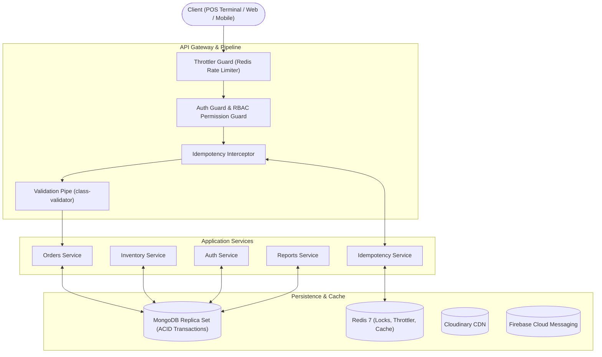
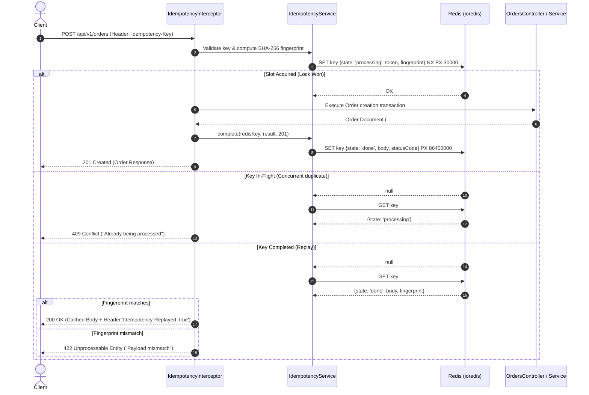

# 🍽️ Point of Sale (POS) & Restaurant Management Backend

> An enterprise-grade, high-performance Point of Sale (POS) and restaurant management backend engine built with **NestJS 11**, **MongoDB (Mongoose)**, and **Redis**.

[](https://nestjs.com/)
[](https://nodejs.org/)
[](https://www.mongodb.com/)
[](https://redis.io/)
[](https://www.typescriptlang.org/)
[](https://swagger.io/)

---

## 📌 Table of Contents

- [Overview](#-overview)
- [Key Features](#-key-features)
- [System Architecture](#-system-architecture)
- [Modules & Capabilities](#-modules--capabilities)
- [Idempotency & State Machine Architecture](#-idempotency--state-machine-architecture)
- [Tech Stack](#-tech-stack)
- [Project Directory Structure](#-project-directory-structure)
- [Getting Started](#-getting-started)
  - [Prerequisites](#prerequisites)
  - [Environment Variables](#environment-variables)
  - [Installation & Admin Seeding](#installation--admin-seeding)
  - [Running the Application](#running-the-application)
  - [Docker Setup](#docker-setup)
- [API Documentation (Swagger)](#-api-documentation-swagger)
- [API Endpoints Overview](#-api-endpoints-overview)
- [Testing](#-testing)
- [License](#-license)

---

## 🚀 Overview

This backend is designed for modern, high-throughput restaurant, cafe, and retail POS environments. It provides strong transaction guarantees (ACID-compliant inventory deductions and order creation via MongoDB replica set transactions), zero-race-condition distributed idempotency protection using Redis, a strict finite state machine for order lifecycles, real-time analytics, and role-based access control.

---

## ✨ Key Features

- **🔐 Robust Auth & Security**:
  - Dual-token JWT (Access & Refresh tokens) with rotation and Argon2id password hashing.
  - Granular Role-Based Access Control (**RBAC**: `ADMIN`, `MANAGER`, `CASHIER`, `USER`) + Dynamic Resource Permission enforcement (`Action` × `Resource`).
  - Single-device and multi-device session revocation (`logout`, `logout-all`).
  - Forgot Password workflow with 6-digit email OTP verification.
  - Symmetric data encryption (`AES-256-CBC`) and cryptographic payload hashing.

- **📦 Atomic Orders Engine**:
  - Multi-document MongoDB transactions for order placement.
  - Atomic inventory decrement and stock validation in a single session.
  - Guaranteed gap-free sequential human-readable order numbers (e.g., `#001`, `#002`) via an atomic counter collection.
  - Strict **Finite State Machine (FSM)** for transitions (`in_process` → `ready` → `completed` / `cancelled`).
  - Atomic cancellation with automatic stock restoration and inventory movement audit ledger entry.

- **🛡️ Distributed Redis Idempotency**:
  - Protects mutating operations (`POST /api/v1/orders`) from network retries, double-clicks, and offline sync replays.
  - Atomic lock reservation using Redis `SET NX PX`.
  - Canonical recursive key-sorted SHA-256 request payload fingerprinting (detects payload tampering with `422 Unprocessable Entity`).
  - User-scoped lock and cache keys (`idempotency:{userId}:{method}:{path}:{key}`).
  - Automatic fail-open resilience when Redis is unreachable.

- **📊 Comprehensive Inventory & Stock Ledger**:
  - Live stock tracking with low-stock reorder thresholds.
  - Complete immutable movement ledger (`SALE`, `SALE_REVERSAL`, `RESTOCK`, `ADJUSTMENT`) with user attribution and reason tracking.

- **📈 Business Analytics & Reports**:
  - High-performance cached dashboard metrics (Daily Sales, Monthly Revenue, Popular Dishes, Low Stock).
  - Advanced reporting engine: sales summary (Gross, Net, AOV), time-series sales trends with continuous zero-filled charts, order type breakdown (dine-in vs. delivery), and inventory valuation.

- **🔔 Multi-Channel Notifications**:
  - Push notifications via Firebase Cloud Messaging (FCM).
  - In-app notification inbox with read/unread tracking and batch mark-as-read.

- **📝 Audit Logging**:
  - Centralized `AuditLogInterceptor` capturing mutative actions across all domains.
  - Historical entity audit trail search (`/api/v1/audit-logs/entity/:entity/:entityId`).

- **⚡ Infrastructure & Reliability**:
  - Distributed 3-tier Redis rate-limiting (`5 req/sec`, `20 req/10s`, `60 req/min`).
  - Global response normalization envelope (`UnifiedResponseInterceptor`).
  - Global error handling with contextual codes and timestamps.
  - 20-second request timeout guard to prevent connection leaks.
  - Image optimization via **Sharp** and cloud storage with **Cloudinary**.

---

## 🏗️ System Architecture



---

## 🔄 Idempotency & State Machine Architecture

### 1. Order Status State Machine

```
              ┌───────────────────────────┐
              │        IN_PROCESS         │
              └───────┬───────────┬───────┘
                      │           │
           ┌──────────┘           └───────────┐
           ▼                                  ▼
     ┌───────────┐                     ┌───────────────┐
     │   READY   │────────────────────►│   CANCELLED   │ (Terminal, Restocks items)
     └─────┬─────┘                     └───────────────┘
           │                                  ▲
           ▼                                  │
    ┌───────────────┐                         │
    │   COMPLETED   │ (Terminal)              │
    └───────────────┘                         │
           │                                  │
           └──────────── (Refund Flow) ───────┘
```

- **Editable Statuses**: An order's descriptive fields (table, phone, delivery info) can only be altered while `IN_PROCESS` or `READY`.
- **Cancellation**: Only permitted from `IN_PROCESS` or `READY`. Automatically executes an atomic transaction restoring item stock levels and appending `SALE_REVERSAL` ledger entries.
- **Terminal States**: `COMPLETED` and `CANCELLED` cannot transition to any other status.

### 2. Distributed Idempotency Flow



---

## 💻 Tech Stack

| Domain | Technology |
|---|---|
| **Framework** | [NestJS v11](https://nestjs.com/) |
| **Language** | [TypeScript v5.7](https://www.typescriptlang.org/) |
| **Database** | [MongoDB](https://www.mongodb.com/) via [Mongoose v9](https://mongoosejs.com/) |
| **Caching & Locking** | [Redis 7](https://redis.io/) via [ioredis v5](https://github.com/redis/ioredis) & `@nestjs/cache-manager` |
| **Authentication** | [Argon2](https://github.com/ranisalt/node-argon2), [@nestjs/jwt](https://github.com/nestjs/jwt) |
| **Validation** | [class-validator](https://github.com/typestack/class-validator) & [class-transformer](https://github.com/typestack/class-transformer) |
| **Documentation** | [Swagger / OpenAPI 3.0](https://swagger.io/) |
| **File Processing** | [Multer](https://github.com/expressjs/multer), [Sharp](https://sharp.pixelplumbing.com/), [Cloudinary SDK](https://cloudinary.com/) |
| **Push Notifications** | [Firebase Admin SDK](https://firebase.google.com/docs/admin/setup) (FCM) |
| **Payments** | [Stripe SDK](https://stripe.com/docs/api) |
| **Mailing** | [Nodemailer](https://nodemailer.com/) |
| **Testing** | [Jest](https://jestjs.io/), [ts-jest](https://kulshekhar.github.io/ts-jest/), [Supertest](https://github.com/ladjs/supertest) |

---

## 📁 Project Directory Structure

```text
pos-backend/
├── src/
│   ├── common/                          # Shared cross-cutting concerns
│   │   ├── cache/                       # CacheModule configuration
│   │   ├── Config/                      # Env validation with class-validator
│   │   ├── constants/                   # Roles, permissions, global constants
│   │   ├── database/                    # Base Mongoose repository & DatabaseModule
│   │   ├── Decorators/                  # @AuthUser, @AuthApply, @CheckPermissions, @FilesUpload
│   │   ├── Dto/                         # ParamIdDto, PaginationDto, PaginatedResponseDto
│   │   ├── Enums/                       # Role, Resource, OrderStatus, OrderType, Action
│   │   ├── Filters/                     # GlobalExceptionFilter
│   │   ├── Guards/                      # AuthGuard, AuthorizationGuard, PermissionGuard
│   │   ├── idempotency/                 # Core Idempotency Subsystem
│   │   │   ├── constants/               # Lock TTL (30s), Result TTL (24h), Key regex
│   │   │   ├── interfaces/              # IdempotencyRecord
│   │   │   ├── services/                # IdempotencyService (Atomic claims, fingerprints)
│   │   │   ├── interceptors/            # IdempotencyInterceptor (HTTP handling & replay)
│   │   │   └── idempotency.module.ts    # IdempotencyModule
│   │   ├── Interceptors/                # UnifiedResponse, Timeout, AuditLogs
│   │   ├── Middleware/                  # LoggerMiddleware
│   │   ├── services/                    # Cloudinary, Firebase, Redis, Payments, Security
│   │   └── utils/                       # Email templates, OTP helpers, Sharp image resizing
│   │
│   ├── Modules/                         # Business Domain Feature Modules
│   │   ├── audit-log/                   # Audit logging and history query
│   │   ├── auth/                        # Login, token refresh, OTP, password recovery
│   │   ├── category/                    # Product category management
│   │   ├── dashboard/                   # High-level cached KPIs & metrics
│   │   ├── inventory/                   # Stock items & ledger movements
│   │   ├── menu/                        # Menu items catalog
│   │   ├── notification/                # FCM tokens, push notifications, user inbox
│   │   ├── orders/                      # Order engine, state machine, atomic restock
│   │   │   ├── constants/               # Order status transitions & editable checks
│   │   │   ├── dto/                     # Strict create/update DTOs & spec tests
│   │   │   ├── model/                   # Orders & Counter Mongoose schemas
│   │   │   ├── repository/              # Order & Counter repositories
│   │   │   └── orders.service.ts        # ACID transactional order processing
│   │   ├── reports/                     # Sales summary, trends, inventory valuation
│   │   ├── reservation/                 # Table & guest reservations
│   │   ├── staff/                       # Staff management & bulk delete
│   │   └── users/                       # User profiles, role changes, avatars
│   │
│   ├── scripts/                         # Operational CLI scripts (seed-admin.ts)
│   ├── app.module.ts                    # Root AppModule assembling all providers
│   └── main.ts                          # App bootstrap, Swagger, Pipes, Global Filters
│
├── docker-compose.yml                   # Docker composition (App + Redis 7)
├── dockerfile                           # Multi-stage / Alpine Node 22 image
├── package.json
└── README.md
```

---

## 🚦 Getting Started

### Prerequisites

Ensure the following tools are installed on your machine:
- **Node.js**: `v20.x` or `v22.x`
- **npm** / **pnpm**
- **MongoDB**: Replica Set instance (required for multi-document ACID transactions; locally you can run `mongod --replSet rs0` or use MongoDB Atlas)
- **Redis**: `v6.x` or `v7.x`

---

### Environment Variables

Copy the provided sample environment configuration:

```bash
cp .env.example .env
```

Review and update the variables in `.env`:

| Key | Description | Example |
|---|---|---|
| `PORT` | HTTP port | `3000` |
| `DATABASE_URI` | MongoDB Connection URI (must support replica set) | `mongodb://localhost:27017/pos_db?replicaSet=rs0` |
| `REDIS_HOST` | Redis server hostname | `localhost` |
| `REDIS_PORT` | Redis server port | `6379` |
| `JWT_SECRET_BEARER_ACCESS` | Secret key for access tokens | `your_access_secret` |
| `JWT_BEARER_ACCESS_EXP` | Access token lifespan in seconds | `3600` (1 hour) |
| `JWT_SECRET_BEARER_REFRESH` | Secret key for refresh tokens | `your_refresh_secret` |
| `JWT_REFRESH_BEARER_EXP` | Refresh token lifespan in seconds | `604800` (7 days) |
| `ADMIN_EMAIL` | Default admin email for seeding | `admin@pos.com` |
| `ADMIN_PASSWORD` | Default admin password for seeding | `Admin@123456` |
| `CLOUDINARY_*` | Cloudinary credentials for media upload | API keys |
| `STRIPE_*` | Stripe API keys & webhook secret | Secret keys |
| `FIREBASE_*` | Firebase service account credentials | JSON / Key strings |

---

### Installation & Admin Seeding

1. **Install dependencies**:
   ```bash
   npm install
   ```

2. **Seed the initial Super Admin user**:
   ```bash
   npm run seed:admin
   ```
   *Creates an admin account based on `ADMIN_EMAIL` and `ADMIN_PASSWORD` defined in `.env`.*

---

### Running the Application

```bash
# Development (with hot-reload watch mode)
npm run start:dev

# Production build
npm run build

# Start production server
npm run start:prod
```

Once running:
- **REST API**: `http://localhost:3000/api/v1`
- **Interactive Swagger Documentation**: `http://localhost:3000/api/docs`

---

### 🐳 Docker Setup

Run both the POS Backend and a Redis instance with Docker Compose:

```bash
# Start all containers in background
docker-compose up -d

# View live container logs
docker-compose logs -f app

# Stop containers
docker-compose down
```

---

## 📖 API Documentation (Swagger)

Interactive OpenAPI documentation is generated automatically and accessible at:

```
http://localhost:3000/api/docs
```

The Swagger interface supports:
- Direct Bearer Token authorization (`access-token`).
- Request body schema validation and parameter exploration.
- Header simulation (including `Idempotency-Key`).

---

## 📋 API Endpoints Overview

All routes are prefixed with `/api/v1`.

### 1. Authentication (`/auth`)
| Method | Endpoint | Description | Auth Required |
|---|---|---|---|
| `POST` | `/auth/login` | Authenticate with email & password | Public |
| `POST` | `/auth/refresh-token` | Obtain new access token via refresh token | Bearer (Refresh) |
| `POST` | `/auth/logout` | Revoke active access and refresh token | Bearer (Access) |
| `POST` | `/auth/logout-all` | Terminate all active sessions across devices | Bearer (Access) |
| `POST` | `/auth/forgot-password` | Request password reset 6-digit OTP email | Public |
| `POST` | `/auth/verify-otp` | Validate reset OTP code | Public |
| `POST` | `/auth/reset-password` | Reset password with verified OTP | Public |

### 2. Orders (`/orders`)
| Method | Endpoint | Description | Headers |
|---|---|---|---|
| `POST` | `/orders` | Place order (atomic stock decrement & `#001` sequence) | `Idempotency-Key` (Optional/Recommended) |
| `GET` | `/orders` | Paginated orders list with search, status, and type filters | Bearer |
| `GET` | `/orders/:id` | Get order details | Bearer |
| `PATCH` | `/orders/:id` | Update status, table, delivery info, or cancel order | Bearer |

### 3. Inventory & Stock Ledger (`/inventory`)
| Method | Endpoint | Description | Auth Required |
|---|---|---|---|
| `POST` | `/inventory` | Create new inventory SKU | Bearer (Write) |
| `GET` | `/inventory` | Paginated inventory listing | Bearer (Read) |
| `GET` | `/inventory/:id` | Get SKU details | Bearer (Read) |
| `PATCH` | `/inventory/:id` | Update SKU details / stock parameters | Bearer (Write) |
| `PATCH` | `/inventory/:id/image` | Upload SKU image (Multipart / Cloudinary) | Bearer (Write) |
| `DELETE` | `/inventory/:id` | Remove inventory item | Bearer (Delete) |

### 4. Menu & Categories (`/menus`, `/category`)
| Method | Endpoint | Description | Auth Required |
|---|---|---|---|
| `POST` | `/menus` | Create menu item | Bearer (Write) |
| `GET` | `/menus` | List menu items | Bearer (Read) |
| `GET` | `/menus/:id` | Get menu item details | Bearer (Read) |
| `PATCH` | `/menus/:id` | Update menu item | Bearer (Write) |
| `DELETE` | `/menus/:id` | Delete menu item | Bearer (Delete) |
| `CRUD` | `/category/*` | Full CRUD operations for menu categories | Bearer |

### 5. Analytics & Dashboard (`/dashboard`)
| Method | Endpoint | Description |
|---|---|---|
| `GET` | `/dashboard/daily-sales` | Cached total gross sales for the current day |
| `GET` | `/dashboard/monthly-revenue` | Cached total revenue for the current month |
| `GET` | `/dashboard/overview` | Monthly sales and order volume graph data |
| `GET` | `/dashboard/popular-dishes` | Top selling menu items |
| `GET` | `/dashboard/low-stock` | Items currently below reorder threshold |

### 6. Business Reports (`/reports`)
| Method | Endpoint | Description |
|---|---|---|
| `GET` | `/reports/sales` | Aggregated sales metrics for date range (Africa/Cairo) |
| `GET` | `/reports/sales/summary` | KPI sales overview (Gross, Net, AOV, cancellations) |
| `GET` | `/reports/sales/trends` | Time-series data grouped by day/week/month (zero-filled) |
| `GET` | `/reports/sales/by-order-type` | Performance comparison: Dine-in vs Delivery |
| `GET` | `/reports/inventory/summary` | SKU counts, in-stock/low-stock counts, retail valuation |
| `GET` | `/reports/inventory/low-stock` | Paginated low-stock items |
| `GET` | `/reports/inventory/movements`| Full stock movement audit log (`SALE`, `RESTOCK`, etc.) |

### 7. Reservations (`/reservations`)
| Method | Endpoint | Description |
|---|---|---|
| `POST` | `/reservations` | Create new table/party reservation |
| `GET` | `/reservations` | List reservations with status & date filters |
| `GET` | `/reservations/:id` | Get reservation details |
| `PATCH` | `/reservations/:id` | Update status, table, or guest details |
| `DELETE` | `/reservations/:id` | Cancel/remove reservation |

### 8. Notifications (`/notification`)
| Method | Endpoint | Description |
|---|---|---|
| `POST` | `/notification/add-fcm-token` | Register device FCM token for push notifications |
| `POST` | `/notification/send-push-notification` | Dispatch push notification |
| `GET` | `/notification/inbox` | Get authenticated user's notification inbox |
| `PATCH` | `/notification/mark-as-read` | Mark notifications as read |
| `DELETE` | `/notification/:id` | Remove notification from inbox |

### 9. Staff & Users (`/staff`, `/users`)
| Method | Endpoint | Description |
|---|---|---|
| `GET` | `/users/profile` | Current authenticated user's profile |
| `POST` | `/users` | Create user (Admin only) |
| `PATCH` | `/users/:id/role` | Promote/demote user role |
| `PATCH` | `/users/:id/permissions` | Modify granular permissions |
| `CRUD` | `/staff/*` | Staff management including bulk delete (`/staff/delete-many`) |

### 10. Audit Logs (`/audit-logs`)
| Method | Endpoint | Description |
|---|---|---|
| `GET` | `/audit-logs` | Query system mutation logs with filters |
| `GET` | `/audit-logs/entity/:entity/:entityId` | Complete historical audit trail for an entity |
| `GET` | `/audit-logs/:id` | Get single audit log record details |

---

## 🧪 Testing

The test suite covers unit testing for controllers, services, state machines, DTO validation, and distributed idempotency.

```bash
# Run all unit tests
npm run test

# Run tests with live watch mode
npm run test:watch

# Generate test coverage report
npm run test:cov

# Run End-to-End (E2E) test suite
npm run test:e2e
```

---

## 📄 License

This project is proprietary and confidential. All rights reserved.
